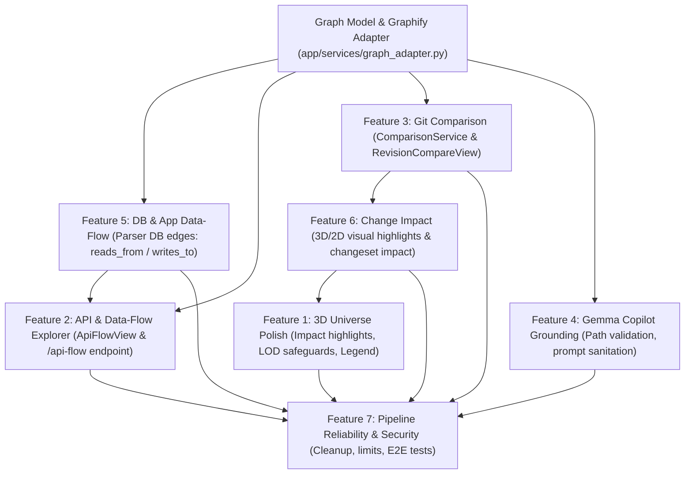

# RepoGraph — Implementation Plan

**Objective:** Implement and verify all seven capabilities in dependency order, bringing RepoGraph to a complete, integrated, production-minded state.

---

## 1. Architectural Architecture & Dependency Graph

---

## 2. Phase-by-Phase Execution Plan

### Phase 1: Graph Adapter & Cross-Layer DB Linking (F5 Foundation)
- **Goal:** Unify the Graphify knowledge graph contract and link application code to database entities.
- **Tasks:**
  - Create [`backend/app/services/graph_adapter.py`](file:///C:/Users/SHUBHAM/.gemini/antigravity/scratch/repograph/backend/app/services/graph_adapter.py) with bidirectional translation between Graphify v1 schema and RepoGraph's `NormalizedGraph`.
  - Enhance [`python_parser.py`](file:///C:/Users/SHUBHAM/.gemini/antigravity/scratch/repograph/backend/app/services/parser/python_parser.py) and [`js_ts_parser.py`](file:///C:/Users/SHUBHAM/.gemini/antigravity/scratch/repograph/backend/app/services/parser/js_ts_parser.py) to extract `reads_from` and `writes_to` edges when functions query or mutate models (e.g. `Order`, `User`, `db.query`, `db.add`).
  - Update `ERDiagramView.tsx` to list connected application functions and allow jumping directly to their code.

### Phase 2: Feature 2 — API and Application Data-Flow Explorer
- **Goal:** End-to-end framework-aware visualization from API routes to downstream services and storage.
- **Tasks:**
  - Implement `GET /api/analyses/{id}/api-routes` and `GET /api/analyses/{id}/api-flow/{route_id}` in [`routes.py`](file:///C:/Users/SHUBHAM/.gemini/antigravity/scratch/repograph/backend/app/api/routes.py).
  - Trace route handlers through middleware, authentication, service functions, and database models.
  - Create [`frontend/src/components/apiflow/ApiFlowView.tsx`](file:///C:/Users/SHUBHAM/.gemini/antigravity/scratch/repograph/frontend/src/components/apiflow/ApiFlowView.tsx).
  - Add `'api'` view tab to [`Header.tsx`](file:///C:/Users/SHUBHAM/.gemini/antigravity/scratch/repograph/frontend/src/components/layout/Header.tsx) and [`App.tsx`](file:///C:/Users/SHUBHAM/.gemini/antigravity/scratch/repograph/frontend/src/App.tsx).

### Phase 3: Feature 3 — Git Branch & Commit Comparison
- **Goal:** Compare two revisions of a repository and visualize differences.
- **Tasks:**
  - Create [`backend/app/services/comparison_service.py`](file:///C:/Users/SHUBHAM/.gemini/antigravity/scratch/repograph/backend/app/services/comparison_service.py).
  - Implement `POST /api/analyses/{id}/compare` endpoint.
  - Support comparison between two repository revisions, computing added, modified, and removed files, symbols, routes, and schemas.
  - Create [`frontend/src/components/compare/RevisionCompareView.tsx`](file:///C:/Users/SHUBHAM/.gemini/antigravity/scratch/repograph/frontend/src/components/compare/RevisionCompareView.tsx).
  - Add `'compare'` view tab in Header and state in `useRepoStore.ts`.
  - Provide a deterministic fixture revision (`ecommerce-platform-v2`) with intentional additions, modifications, and removals.

### Phase 4: Feature 6 & Feature 1 — Change Impact & 3D Universe Polish
- **Goal:** Connect impact analysis to 3D/2D visualization and complete performance safeguards.
- **Tasks:**
  - In `useRepoStore.ts`, store active impact nodes.
  - In `UniverseCanvas.tsx` and `FlowCanvas.tsx`, highlight direct dependents (amber glow) and transitive dependents (rose glow).
  - Add large-graph performance safeguards (node threshold indicator, adaptive rendering).
  - Complete floating legend with edge types and confidence badges.

### Phase 5: Feature 4 — Evidence-Grounded Gemma Architecture Copilot
- **Goal:** Bulletproof prompt safety and strict source reference verification.
- **Tasks:**
  - Add sanitization against prompt injection in user queries.
  - Validate model-returned file paths and line ranges against verified analysis nodes before presentation.
  - Preserve high-speed fallback (`gemini-flash-lite-latest`) for resilience against Google Gemma server outages.

### Phase 6: Feature 7 — Security, Reliability, & Verification
- **Goal:** Comprehensive end-to-end testing, error handling, and documentation.
- **Tasks:**
  - Automated tests for `comparison_service`, `graph_adapter`, `api_flow`, and impact canvas integration.
  - Verify resource limits and archive cleanup.
  - Update `docs/feature-audit.md`, `README.md`, and `SECURITY.md`.
